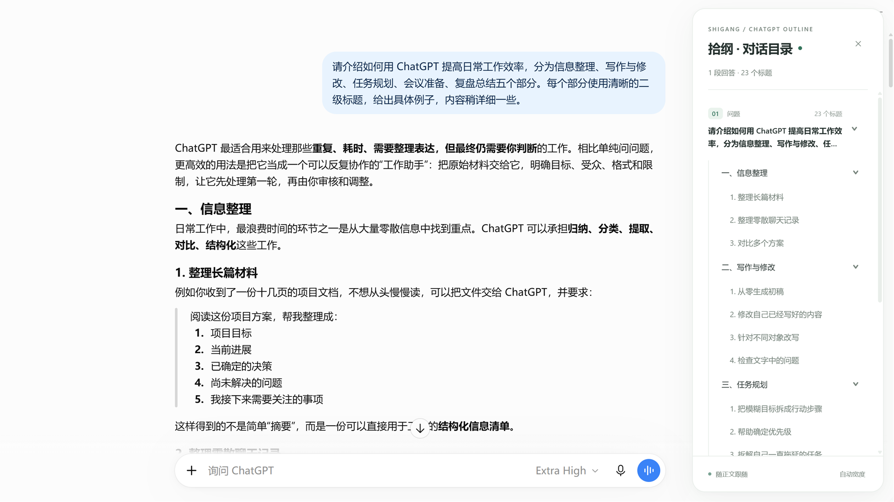
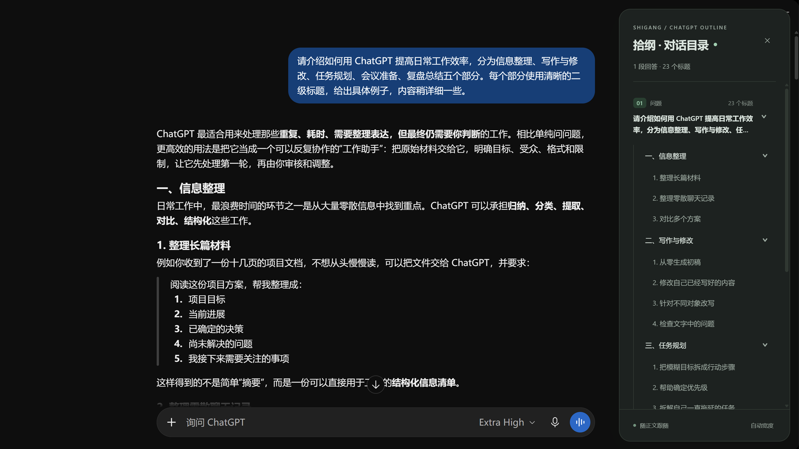

# Shigang - ChatGPT Table of Contents

[简体中文](README.md) | **English**

Shigang adds a collapsible table of contents to long ChatGPT conversations. Browse headings, jump to a section, and follow your reading position without scrolling back and forth.

[Chrome Web Store](https://chromewebstore.google.com/detail/shigang-chatgpt-table-of/gnkgnojbcclcfjelkijmhaaboidhnehk) · [Microsoft Edge Add-ons](https://microsoftedge.microsoft.com/addons/detail/kojdleblcoelmniokkifjjfhmjeaddfj) · [Release v1.0.4](https://github.com/quantai1314/gpt-toc-extension/releases/tag/v1.0.4) · [Report an issue](https://github.com/quantai1314/gpt-toc-extension/issues)

## Features

- Group H1–H6 headings by assistant response, with the related user prompt.
- Jump to a heading or prompt, and collapse responses or nested sections.
- Follow the current reading position without highlighting the conversation.
- Resize the sidebar and save your preferred width on this device. The sidebar adjusts to available space and collapses when space is insufficient.
- Preserve rendered Markdown and math in headings and prompt summaries, including fractions, powers and matrices when the page provides MathML.
- Update while responses stream and when you switch conversations, excluding hidden cached conversations.
- Support light and dark themes, keyboard navigation, English and Simplified Chinese interface labels.

## Install and update

Install from the [Chrome Web Store](https://chromewebstore.google.com/detail/shigang-chatgpt-table-of/gnkgnojbcclcfjelkijmhaaboidhnehk) or [Microsoft Edge Add-ons](https://microsoftedge.microsoft.com/addons/detail/kojdleblcoelmniokkifjjfhmjeaddfj). Refresh [ChatGPT](https://chatgpt.com/) and click **Outline** near the upper-right corner. Store updates are managed by your browser.

For manual installation:

1. Download **shigang-chatgpt-outline-1.0.3.zip** from the [release page](https://github.com/quantai1314/gpt-toc-extension/releases/tag/v1.0.3) and extract it to a folder you will keep.
2. Open `chrome://extensions/` or `edge://extensions/` and enable **Developer mode**.
3. Click **Load unpacked** and select the folder directly containing `manifest.json`.
4. Refresh ChatGPT and click **Outline**.

Node.js and npm are not needed for installation. Keep the extracted folder in place. When updating a manually loaded extension, reload it on the extensions page and then refresh ChatGPT. Disable an older copy if it creates a second outline panel.

If an existing ChatGPT tab reports `Extension context invalidated` after reloading the extension, refresh that ChatGPT tab to replace its old content script. The localization helper falls back to bundled messages when its extension API becomes invalid and stops repeatedly calling that API. Previously recorded errors can be cleared after refreshing the affected tab.

## Screenshots

Real usage in light and dark mode, using a Chinese sample conversation. The account avatar and left navigation were cropped out.

## Offline preview

Download and extract the [repository source](https://github.com/quantai1314/gpt-toc-extension/archive/refs/heads/main.zip), then open [ui-preview.html](ui-preview.html) in your browser. This self-contained demo includes sample content and runs without a server, ChatGPT login or extension installation. It is included in the repository source, rather than the extension-only release ZIP.

## Privacy and limitations

Outline processing takes place locally in your browser. Shigang does not upload conversations or provide telemetry. Only your sidebar width preference is saved locally; messages, outline entries, reading position and folding state are not persisted. **Auto width** clears the saved width preference. See the [privacy policy](PRIVACY.md).

On the newer page layout, opening the outline automatically scans history to mount older turns, then restores your reading position. The page may briefly scroll during scanning. Reading or interacting with the conversation pauses the scan; use **Refresh** in the outline footer to retry. Cached outline entries survive virtualized message unloading, and clicking an older heading reloads its target. The cache lives only in page memory and is cleared when switching conversations. No backend conversation API or persistent chat storage is used. Messages the website fails to load may still be missing; older layouts index their currently loaded messages.

Thinking and tool activities within a turn do not become duplicate answers. Pending and interrupted responses have distinct states, and updates retry automatically after an outline error. **Refresh** updates the outline and history scan without resending your prompt. Responses without H1–H6 headings do not generate heading entries. Math is taken from the page's existing rendered structures; the extension does not download a math library. Changes to the ChatGPT website may affect compatibility.

## Release status

Version **1.0.4** was prepared on **2026-10-20 (Asia/Shanghai)** with thinking/tool deduplication, retained history outlines, cached heading navigation and error recovery fixes.

- [GitHub Release v1.0.4](https://github.com/quantai1314/gpt-toc-extension/releases/tag/v1.0.4) provides the extension ZIP for manual loading.
- [Microsoft Edge Add-ons](https://microsoftedge.microsoft.com/addons/detail/kojdleblcoelmniokkifjjfhmjeaddfj): 1.0.4 was uploaded and submitted; the developer dashboard shows **In review**. Existing version 1.0.3 remains **Live**.
- [Chrome Web Store](https://chromewebstore.google.com/detail/shigang-chatgpt-table-of/gnkgnojbcclcfjelkijmhaaboidhnehk): the public version remains 1.0.3. Browser tooling denied access to the developer dashboard, so 1.0.4 has not been uploaded or submitted there. Upload the same ZIP manually and submit it for review.

Package: `shigang-chatgpt-outline-1.0.4.zip`. SHA-256: `a235fd5dde3eff25b7571b1f7fb1da923c33351e4160d501e4b2f52b14240e65`. Package contents and versions were checked; no new permissions were added. All 59 Chrome browser regressions passed. These checks do not establish store approval or replace testing the updated extension in a real long conversation.

Both public stores display the previously submitted real light/dark screenshots. The [dated verification record](docs/store-listing-verification-2026-10-20.md) documents the public 1.0.3 listings before this functional update, including source URLs, hashes and comparison details.

## Source and license

Maintained by [quantai1314](https://github.com/quantai1314), based on [WindZZzzZZzz/gpt-toc-extension](https://github.com/WindZZzzZZzz/gpt-toc-extension). The original MIT copyright and [license](LICENSE) are retained. Compatibility fixes were also submitted upstream in [PR #20](https://github.com/WindZZzzZZzz/gpt-toc-extension/pull/20).

For development instructions and the dated regression-check records, see the [Chinese README](README.md#本地开发与检查) and [changelog](CHANGELOG.md).
